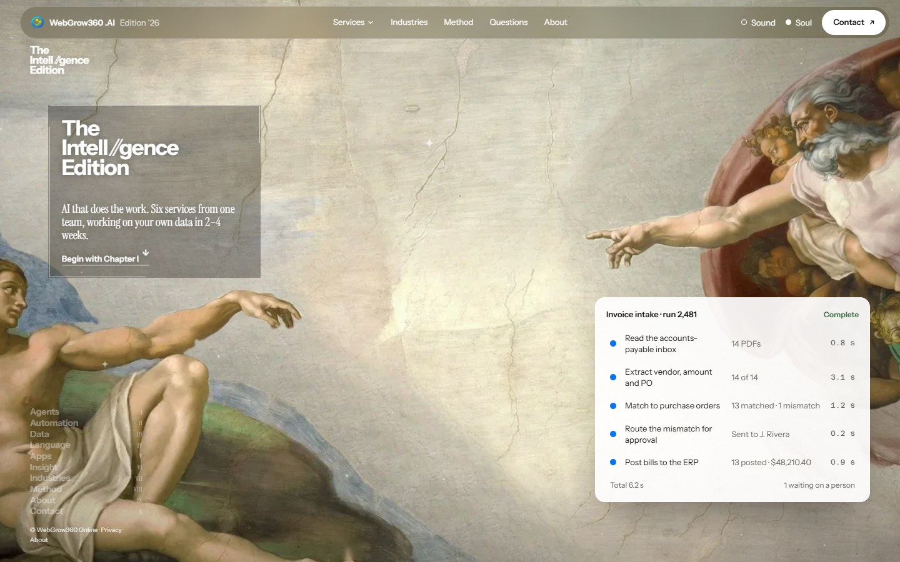

# WebGrow360 .AI — The Intell//gence Edition



The website of **WebGrow360 .AI**, the AI arm of the WebGrow360 group (Kolkata, India): AI agents, workflow automation,
data pipelines, LLM integration, AI apps and process intelligence for growing businesses.

The site is built as an editorial "edition": each service is a chapter that opens on an old-master painting, tears away
into parchment, and shows the systems we build as live interface fragments.

## Highlights

- **Hero** — the Creation of Adam in three layers. Scrolling brings the figures together through four eras of dress
  until the fingertips touch, a ragged void opens and the painting turns to glowing line art (WebGL).
- **Six service chapters** — each a pinned painting with a scroll-scrubbed Ken Burns, a glass card showing a sample
  workflow, and a study section. Data's stage is a scroll-scrubbed film (Babel → 1800s mahal → 2026 skyline).
- **Living torn edges** — a WebGL noise-threshold wipe with a bright fibre rim and grain-driven glitter, one shared
  context for every edge.
- **Shatter transitions** between chapters, into present-day remakes of the next painting.
- **Glass navigation** — services mega menu, text-swap links, contact button, focus-trapped drawer on phones.
- **Footer** — orbiting rings of type, a growing disc with the call to action, a pixel dissolve into parchment, and a
  wordmark that assembles from pixels.
- **Pages** — home, six service pages, About (leadership playing cards that morph into detail cards), Contact
  (validated enquiry form), Privacy policy and Terms of service.
- **Phones** — paintings are framed so at least 58% of their width shows (`src/lib/fit.ts`), with compact cards and
  larger tap targets.
- **Accessibility** — keyboard and focus handling throughout, and `prefers-reduced-motion` respected by every effect.

## Stack

Next.js 16 (App Router, Turbopack) · React 19 · TypeScript · three.js · Lenis smooth scroll · plain CSS.
Every page is prerendered. Scroll effects share one engine (`src/lib/scroll.ts`); there is no GSAP or Framer Motion.

## Getting started

Requires Node.js 20 or newer.

```bash
npm install
npm run dev                      # http://localhost:3000
npm run build && npm run start   # production build
npm run lint
```

## Where things live

| What | Where |
| --- | --- |
| Company details: name, email, phone, address, booking link, group sites, markets | `src/lib/site.ts` |
| Services and their copy, FAQs | `src/lib/services.ts` |
| Chapters, paintings and their credits, hero eras, shatter images | `src/lib/chapters.ts` |
| Leadership and company story | `src/lib/team.ts` |
| Home page | `src/app/page.tsx` |
| Service pages (`/services/<slug>`) | `src/app/services/[slug]/page.tsx` |
| About, Contact, Privacy, Terms | `src/app/about`, `src/app/contact`, `src/app/privacy`, `src/app/terms` |
| Hero (layers, eras, touch) and its WebGL effects | `src/components/Hero.tsx`, `src/components/HeroFx.ts` |
| Chapter stage, phone framing | `src/components/Stage.tsx`, `src/lib/fit.ts` |
| Torn edges (WebGL) | `src/components/TornEdge.tsx` |
| Navigation | `src/components/Nav.tsx` |
| Footer | `src/components/Footer*.tsx` |
| Styles and design tokens | `src/app/globals.css` |
| Images, film, team photos | `public/` |

## Images and credits

- The paintings are public domain, via Wikimedia Commons, and are credited in the site footer.
- The hero eras, the studio props and photographs, the present-day painting remakes, the About painting and the Data
  film were generated for this site with Google Flow.
- The scripts in `scripts/` prepared those images (cut-outs, era layers, video encoding). They expect source files in
  `.art-src/` and a Python virtual environment in `.art-work/`, which are kept out of the repository.
- Scramble Text is adapted from dqnamo on 21st.dev.

## Before launch

- The contact form and newsletter open the visitor's email app (`mailto:`); connect a form backend to store
  submissions.
- The Privacy policy and Terms of service are drafted for Indian law (DPDP Act 2023, IT Act 2000, Arbitration and
  Conciliation Act 1996) and should be reviewed by a lawyer.
- Interface fragments on the site show sample data.
- Confirm the production domain in `src/lib/site.ts` (currently `ai.webgrow360.online`).
